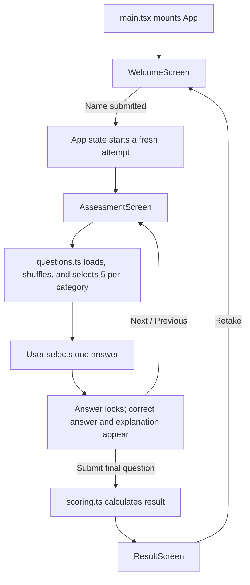

# German A1 Exam Readiness Checker

A lightweight, responsive React application that helps German A1 learners assess their preparation through short Vocabulary, Grammar, and Reading exercises. Each attempt contains 15 randomized multiple-choice questions. At the end, learners see their overall score, category breakdown, readiness level, and targeted practice tips.

> This app provides a practice-based readiness estimate. Its score is not an official Goethe or OSD exam result or certification.

## Live app

[Open the German A1 Readiness Checker](https://german-a1-readiness-checker.vercel.app/)

## Features

- Five questions each in Vocabulary, Grammar, and Reading: 15 questions total.
- Questions are randomly selected from the category banks for each attempt.
- One question at a time, with a progress bar and Previous/Next navigation.
- The first selected answer is locked. The correct answer and an explanation appear after selection.
- Overall score, category breakdown, and up to three practice recommendations for missed topics.
- Readiness levels: below 60% is `Needs Practice`, 60% to 79% is `Almost Ready`, and 80% or above is `Ready`.
- A success banner and confetti-style celebration appear for `Ready` results.
- Retaking starts a fresh randomized question set.

## Technology stack

- React 18
- TypeScript
- Vite 6
- Tailwind CSS 3
- PostCSS and Autoprefixer

## Run locally

### Requirements

- Node.js and npm installed on your machine.
- A terminal opened in the project directory.

### Install dependencies and start the development server

```bash
npm install
npm run dev
```

Vite prints a local URL in the terminal. It is usually `http://localhost:5173/`. Open that URL in a browser to use the app. Press `Ctrl+C` in the terminal to stop the development server.

### Create and preview a production build

```bash
npm run build
npm run preview
```

`npm run build` runs the TypeScript project build check and creates optimized production files in `dist/`. `npm run preview` serves that production build locally.

## Architecture

This is a single-page React application. `App.tsx` coordinates navigation between the three screens and holds shared state. Question content lives in JSON files, question selection is handled by `questions.ts`, and scoring is calculated separately from the UI in `scoring.ts`.



### Main data flow

1. `src/main.tsx` renders `App` into the browser's `#root` element.
2. `src/App.tsx` first displays `WelcomeScreen`. When the user submits a name, the name is saved and the assessment begins.
3. `src/data/questions.ts` loads the three active JSON question banks, then randomly selects five questions from each category. The selection is created once when the assessment screen mounts.
4. `AssessmentScreen` displays one question at a time and saves the user's first selected option. The option is locked, then feedback shows whether it was correct, the correct answer, and its explanation.
5. Submitting the final question calls `calculateResult()`, which calculates correct answers, the percentage, category scores, and missed topics.
6. `ResultScreen` shows the readiness level and practice recommendations. Scores of 80% or above also trigger a celebration banner and confetti.
7. Retake returns the user to the welcome screen. Starting again remounts the assessment and creates a fresh randomized question set.

## Readiness calculation

| Score | Level | Guidance |
| --- | --- | --- |
| Below 60% | Needs Practice | Focus on the weaker areas |
| 60% to 79% | Almost Ready | Review missed topics and try again |
| 80% or above | Ready | Meets this app's readiness benchmark; celebration is shown |

Each correct answer earns one point. Incorrect answers earn zero points; there is no negative marking. The percentage is calculated as `correct answers / total questions`. The assessment requires an answer before the user can continue, so unanswered questions cannot normally be submitted.

## Repository structure

```text
.
├── .gitignore
├── grammer/
│   ├── a1_grammer.json
│   └── mcqs.json
├── reading/
│   ├── a1_reading.json
│   └── mcqs.json
├── vocabulary/
│   ├── a1_vocabulary.json
│   └── mcqs.json
├── public/
│   └── vite.svg
├── src/
│   ├── components/
│   │   ├── screens/
│   │   │   ├── AssessmentScreen.tsx
│   │   │   ├── ResultScreen.tsx
│   │   │   ├── WelcomeScreen.tsx
│   │   │   └── index.ts
│   │   └── ui/
│   │       ├── Button.tsx
│   │       ├── ProgressBar.tsx
│   │       └── index.ts
│   ├── data/
│   │   └── questions.ts
│   ├── types/
│   │   └── index.ts
│   ├── utils/
│   │   └── scoring.ts
│   ├── App.tsx
│   ├── index.css
│   └── main.tsx
├── index.html
├── initial_app_building_prompt.md
├── package.json
├── package-lock.json
├── postcss.config.js
├── README.md
├── tailwind.config.js
├── tsconfig.json
├── vite.config.ts
└── vite-env.d.ts
```

## File-by-file guide

### App entry points and screens

| File | Purpose |
| --- | --- |
| `index.html` | Provides the browser HTML shell, page title, viewport settings, favicon, and `#root` element. Vite loads the React entry point from here. |
| `src/main.tsx` | Creates the React root, renders `App`, and imports the global stylesheet. |
| `src/App.tsx` | Coordinates navigation between Welcome, Assessment, and Result screens. It keeps the candidate name, assessment result, and fresh-attempt key in state. |
| `src/components/screens/WelcomeScreen.tsx` | Displays the app introduction and test details, then collects a name before starting. |
| `src/components/screens/AssessmentScreen.tsx` | Displays the current question, reading passage, answer options, progress, and navigation. It locks the first answer and shows the correct answer and explanation. It submits the completed assessment for scoring. |
| `src/components/screens/ResultScreen.tsx` | Displays the overall score, readiness result, category breakdown, and practice recommendations. It also shows a celebration for `Ready` results. |
| `src/components/screens/index.ts` | Re-exports the screen components through a single barrel file. |

### Data, types, scoring, and reusable UI

| File | Purpose |
| --- | --- |
| `src/data/questions.ts` | Imports the active A1 JSON banks, maps raw records into app question objects, shuffles them, and selects five per category. |
| `src/utils/scoring.ts` | Calculates correct answers, category scores, percentage, readiness level, and up to three practice tips for missed topics. |
| `src/types/index.ts` | Defines the TypeScript types for `Question`, `UserAnswer`, `AssessmentResult`, categories, readiness levels, and screens. |
| `src/components/ui/Button.tsx` | Provides a reusable button with primary, secondary, and outline variants. |
| `src/components/ui/ProgressBar.tsx` | Displays the current question number and assessment progress. |
| `src/components/ui/index.ts` | Re-exports reusable UI components through a single barrel file. |
| `src/index.css` | Includes Tailwind directives, the root layout, and pass celebration animations. It also respects reduced-motion preferences. |

### Question banks

| File | Purpose |
| --- | --- |
| `vocabulary/a1_vocabulary.json` | Active A1 vocabulary questions and answer explanations. |
| `grammer/a1_grammer.json` | Active A1 grammar questions and answer explanations. The folder is named `grammer` in this project, and imports use that spelling. |
| `reading/a1_reading.json` | Reading passages, comprehension questions, and passage-based explanations. |
| `vocabulary/mcqs.json` | Additional or alternate vocabulary MCQ data; the current assessment loader does not import this file. |
| `grammer/mcqs.json` | Additional or alternate grammar MCQ data; the current assessment loader does not import this file. |
| `reading/mcqs.json` | Additional or alternate reading MCQ data; the current assessment loader does not import this file. |

An active `a1_*.json` question record has roughly this shape:

```json
{
  "id": "g1",
  "question": "Ich ___ aus Deutschland.",
  "options": ["bist", "komme", "kommt", "kommen"],
  "correctAnswer": 1,
  "explanation": "With ich, kommen takes the -e ending: ich komme.",
  "topic": "Present-tense verb conjugation",
  "practiceTip": "Practise common present-tense verb forms."
}
```

`correctAnswer` is a zero-based option index: the first option is `0`, the second is `1`, the third is `2`, and the fourth is `3`. Keep exactly four options in each active question. Reading records also include a `passage`. When adding a question, provide a unique `id`, the correct option index, an explanation, a topic, and a useful `practiceTip`.

### Project configuration and supporting files

| File | Purpose |
| --- | --- |
| `package.json` | Defines project scripts and React, Vite, TypeScript, and Tailwind dependencies. |
| `package-lock.json` | Locks npm dependency versions to keep installs consistent. |
| `vite.config.ts` | Enables the React plugin and maps the `@/` alias to `src/`. |
| `tsconfig.json` | Defines TypeScript compiler options, strict checks, JSON imports, and the `@/*` path alias. |
| `vite-env.d.ts` | Enables Vite client-side type declarations. |
| `tailwind.config.js` | Defines Tailwind content paths, primary colors, and the sans-serif font stack. |
| `postcss.config.js` | Runs Tailwind CSS and Autoprefixer through PostCSS. |
| `.gitignore` | Excludes `node_modules`, build output, IDE files, and local environment files from Git. |
| `public/vite.svg` | Static Vite favicon referenced by `index.html`. |
| `initial_app_building_prompt.md` | The original product and build brief; it is not part of the runtime app. |
| `README.md` | Project overview, architecture, setup, user flow, and file reference. |

## Deployment notes

For a Vercel deployment, use these Vite project settings:

- Build command: `npm run build`
- Output directory: `dist`
- Install command: `npm install`

Live deployment: [german-a1-readiness-checker.vercel.app](https://german-a1-readiness-checker.vercel.app/).

## Scope notes

- The app is frontend-only. This repository does not include a backend API, database, authentication, or user accounts.
- Question pools are bundled JSON files. Changes to questions require a new build and deployment to appear in the live app.
- Each attempt selects five questions from each category, so every active category pool must contain at least five valid records.
