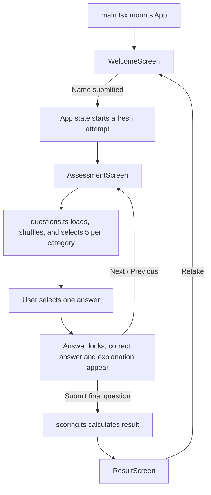

# German A1 Exam Readiness Checker

Ek lightweight, responsive React app jo German A1 learners ko Vocabulary, Grammar aur Reading ke short assessment ke zariye apni preparation check karne mein help karti hai. Har attempt mein 15 randomized multiple-choice questions aate hain. Result mein overall score, category breakdown, readiness level aur targeted practice tips milte hain.

> Yeh app ek practice aur readiness estimate deta hai. Iska score Goethe ya ÖSD ka official exam result ya certification nahi hai.

## Live app

[German A1 Readiness Checker kholo](https://german-a1-readiness-checker.vercel.app/)

## Features

- Vocabulary, Grammar aur Reading mein se 5-5 questions: total 15 questions.
- Har attempt mein question banks se random selection.
- Ek waqt mein ek question, progress bar, aur Previous/Next navigation.
- Pehla selected answer lock ho jata hai. Uske baad sahi answer aur uski explanation dikhai deti hai.
- Score ke saath category-wise breakdown aur kamzor topics ke liye top practice recommendations.
- Readiness levels: 60% se kam `Needs Practice`, 60% se 79% `Almost Ready`, 80% ya zyada `Ready`.
- `Ready` result par success banner aur confetti-style celebration.
- Retake option se naya randomized question set.

## Technology

- React 18
- TypeScript
- Vite 6
- Tailwind CSS 3
- PostCSS aur Autoprefixer

## Local setup

### Requirements

- Node.js aur npm installed hone chahiye.
- Terminal mein project folder tak jaayein.

### Install aur start

```bash
npm install
npm run dev
```

Vite terminal mein local URL dikhayega. Aam taur par woh `http://localhost:5173/` hota hai. URL browser mein kholkar app use karein. Development server ko rokne ke liye terminal mein `Ctrl+C` dabayein.

### Production build

```bash
npm run build
npm run preview
```

`npm run build` pehle TypeScript project build check chalata hai aur phir Vite optimized files `dist/` folder mein banata hai. `npm run preview` us production build ko local preview server par serve karta hai.

## Architecture

App ek single-page React app hai. `App.tsx` teen screens ke beech navigation aur shared state sambhalta hai. Question content JSON files mein hai, question selection `questions.ts` mein hoti hai, aur scoring `scoring.ts` mein UI se alag calculate hoti hai.



### Main data flow

1. `src/main.tsx` browser ke `#root` element mein `App` render karta hai.
2. `src/App.tsx` pehle `WelcomeScreen` dikhata hai. User naam submit kare to naam save hota hai aur assessment screen khulti hai.
3. `src/data/questions.ts` teen active JSON question banks se har category ke 5 questions randomly select karta hai. Assessment mount hone par yeh selection ek baar banti hai.
4. `AssessmentScreen` ek question dikhata hai aur user ka pehla selected option save karta hai. Option lock hone ke baad UI selected answer ka feedback, correct option aur explanation dikhati hai.
5. Final question submit hone par `calculateResult()` correct answers, percentage, category scores aur missed topics calculate karta hai.
6. `ResultScreen` readiness level aur practice suggestions dikhata hai. Score 80% ya zyada ho to celebration banner aur confetti dikhte hain.
7. Retake se Welcome screen par wapas jaate hain. Naya attempt start karne par assessment remount hota hai aur fresh random set milta hai.

## Readiness calculation

| Score | Level | Result message |
| --- | --- | --- |
| Below 60% | Needs Practice | Weak areas par focus karein |
| 60% to 79% | Almost Ready | Kamzor topics review karein |
| 80% or above | Ready | Readiness check pass; celebration dikhai deti hai |

Har sahi answer 1 point deta hai. Galat answer 0 points deta hai; negative marking nahi hai. Result `correct / total` ke percentage se banta hai. Assessment screen par har question ka answer zaroori hai, isliye user unanswered question ke saath aage nahi badh sakta.

## Repository structure

```text
.
├── .gitignore
├── grammer/
│   ├── a1_grammer.json
│   └── mcqs.json
├── reading/
│   ├── a1_reading.json
│   └── mcqs.json
├── vocabulary/
│   ├── a1_vocabulary.json
│   └── mcqs.json
├── public/
│   └── vite.svg
├── README.md
├── src/
│   ├── components/
│   │   ├── screens/
│   │   │   ├── AssessmentScreen.tsx
│   │   │   ├── ResultScreen.tsx
│   │   │   ├── WelcomeScreen.tsx
│   │   │   └── index.ts
│   │   └── ui/
│   │       ├── Button.tsx
│   │       ├── ProgressBar.tsx
│   │       └── index.ts
│   ├── data/
│   │   └── questions.ts
│   ├── types/
│   │   └── index.ts
│   ├── utils/
│   │   └── scoring.ts
│   ├── App.tsx
│   ├── index.css
│   └── main.tsx
├── index.html
├── package.json
├── package-lock.json
├── initial_app_building_prompt.md
├── postcss.config.js
├── tailwind.config.js
├── tsconfig.json
├── vite.config.ts
└── vite-env.d.ts
```

## File-by-file guide

### App entry points and screens

| File | Kya karta hai |
| --- | --- |
| `index.html` | Browser HTML shell, page title, viewport settings, favicon aur `#root` element deta hai. Vite yahin se React entry point load karta hai. |
| `src/main.tsx` | React root create karke `App` render karta hai; global stylesheet import karta hai. |
| `src/App.tsx` | Welcome, Assessment aur Result screen ke beech navigation chalata hai. Candidate name, assessment result aur fresh-attempt key state mein rakhta hai. |
| `src/components/screens/WelcomeScreen.tsx` | App intro, test details aur name-entry dialog dikhata hai. Valid naam submit hone par `onStart` call karta hai. |
| `src/components/screens/AssessmentScreen.tsx` | Current question, reading passage, answer options, progress aur navigation dikhata hai. First answer lock karta hai aur feedback panel mein correct answer plus explanation show karta hai. Final submit par scoring function call karta hai. |
| `src/components/screens/ResultScreen.tsx` | Overall score, readiness result, category breakdown aur practice recommendations dikhata hai. `Ready` result par celebration bhi dikhata hai. |
| `src/components/screens/index.ts` | Screen components ko ek barrel export se expose karta hai. |

### Data, types, scoring aur reusable UI

| File | Kya karta hai |
| --- | --- |
| `src/data/questions.ts` | Active A1 JSON banks import karta hai, raw records map karta hai, questions shuffle karta hai, aur har category se 5 select karke 15-question set banata hai. |
| `src/utils/scoring.ts` | Correct answers, category scores, percentage, readiness level aur missed topics ke top 3 practice tips calculate karta hai. |
| `src/types/index.ts` | `Question`, `UserAnswer`, `AssessmentResult`, category, readiness level aur screen ke TypeScript types define karta hai. |
| `src/components/ui/Button.tsx` | Primary, secondary aur outline variants wala reusable button deta hai. |
| `src/components/ui/ProgressBar.tsx` | Current question aur total ke basis par progress label aur bar dikhata hai. |
| `src/components/ui/index.ts` | UI components ko barrel export se expose karta hai. |
| `src/index.css` | Tailwind directives, root layout aur pass celebration ke animations define karta hai. Reduced-motion preference ko bhi respect karta hai. |

### Question banks

| File | Kya rakhta hai |
| --- | --- |
| `vocabulary/a1_vocabulary.json` | Vocabulary ke active A1 questions aur answer explanations. |
| `grammer/a1_grammer.json` | Grammar ke active A1 questions aur answer explanations. Folder name project mein `grammer` hi hai; imports bhi isi naam ko use karte hain. |
| `reading/a1_reading.json` | Reading passages, comprehension questions aur passage-based explanations. |
| `vocabulary/mcqs.json` | Additional/alternate vocabulary MCQ data; current assessment loader is file ko import nahi karta. |
| `grammer/mcqs.json` | Additional/alternate grammar MCQ data; current assessment loader is file ko import nahi karta. |
| `reading/mcqs.json` | Additional/alternate reading MCQ data; current assessment loader is file ko import nahi karta. |

Active `a1_*.json` question record ka shape roughly yeh hai:

```json
{
  "id": "g1",
  "question": "Ich ___ aus Deutschland.",
  "options": ["bist", "komme", "kommt", "kommen"],
  "correctAnswer": 1,
  "explanation": "With ich, kommen takes the -e ending: ich komme.",
  "topic": "Present-tense verb conjugation",
  "practiceTip": "Practise common present-tense verb forms."
}
```

`correctAnswer` zero-based option index hai: pehla option `0`, doosra `1`, teesra `2`, chautha `3`. Har active question mein exactly four options rakhein. Reading record mein `passage` bhi add karein. New question add karte waqt unique `id`, correct index, explanation, topic aur useful `practiceTip` dena behtar hai.

### Project configuration and supporting files

| File | Kya karta hai |
| --- | --- |
| `package.json` | Project scripts aur React/Vite/TypeScript/Tailwind dependencies define karta hai. |
| `package-lock.json` | npm dependency versions lock karta hai, taaki installs consistent rahen. |
| `vite.config.ts` | React plugin enable karta hai aur `@/` alias ko `src/` se map karta hai. |
| `tsconfig.json` | TypeScript compiler options, strict checks, JSON imports aur `@/*` path alias define karta hai. |
| `vite-env.d.ts` | Vite client-side type declarations enable karta hai. |
| `tailwind.config.js` | Tailwind content paths, primary colors aur sans-serif font define karta hai. |
| `postcss.config.js` | Tailwind CSS aur Autoprefixer ko PostCSS ke zariye process karta hai. |
| `.gitignore` | `node_modules`, build output, IDE files aur local env files ko Git se ignore karta hai. |
| `public/vite.svg` | Static Vite favicon; `index.html` mein reference hota hai. |
| `initial_app_building_prompt.md` | Project ko shuru karne ke liye original product/build brief. Runtime code ka hissa nahi hai. |

## Deployment notes

Vercel deployment ke liye Vite project ko in settings ki zaroorat hoti hai:

- Build command: `npm run build`
- Output directory: `dist`
- Install command: `npm install`

Live deployment yahan hai: [german-a1-readiness-checker.vercel.app](https://german-a1-readiness-checker.vercel.app/).

## Scope notes

- App frontend-only hai: is repo mein backend API, database, authentication ya user account flow nahi hai.
- Question pools bundled JSON files se aate hain; deployment ke baad question edits ke liye naya build/deploy chahiye.
- Har attempt mein har category se 5 questions select hote hain, isliye active pools mein kam se kam 5 valid records per category hone chahiye.
